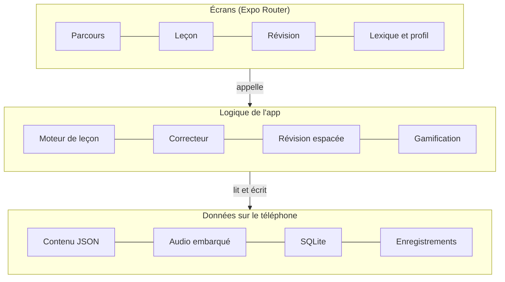

# Cahier des charges — Wolingo, application mobile d'apprentissage du wolof

**Date :** 18 octobre 2026 · **Auteur :** Mohamed Cheikh — AFRICATECHNOLOGIE / E-DEV

<p align="center"></p>

---

## 1. Contexte et objectifs

Wolingo transforme le cours « Initiation au Wolof — Méthode rapide » de Xavier Bry (10 unités) en parcours mobile interactif, utilisable hors ligne, sur Android et iOS. Elle est développée en Expo / React Native par AFRICATECHNOLOGIE / E-DEV.

Objectifs mesurables de la version 1 :

- Couvrir les 10 unités du cours, découpées en leçons courtes de 5 à 10 minutes.
- Proposer 4 familles d'exercices : QCM, traduction, construction de phrase, écoute et prononciation.
- Fonctionner à 100 % sans connexion après installation (contenu et audio embarqués).
- Garder l'apprenant motivé grâce à des animations, de l'XP et une série de jours consécutifs.

Hors périmètre V1 : comptes utilisateurs, synchronisation cloud, paiement, classement entre joueurs.

## 2. Public cible

Le cours est écrit en français : la V1 vise des francophones débutants en wolof.

| Persona | Profil | Besoin principal |
| --- | --- | --- |
| Expatrié ou coopérant | Francophone installé à Dakar ou Saint-Louis | Se débrouiller au marché, en taxi, avec les voisins |
| Diaspora | Jeune d'origine sénégalaise né en Europe | Comprendre la famille, renouer avec la langue |
| Touriste ou étudiant | Séjour court ou stage au Sénégal | Salutations, nombres, argent en dërëm |
| Apprenant E-DEV Academy | Élève suivant une formation encadrée | Réviser les unités entre deux séances |

Prérequis : savoir lire le français. Aucun prérequis en wolof.

## 3. Identité visuelle

Wolingo a sa propre marque : un W formé de trois flammes vert, jaune et rouge, aux couleurs du drapeau sénégalais, posé sur un livre ouvert.

| Rôle | Couleur | Code (relevé sur le logo) | Usage dans l'app |
| --- | --- | --- | --- |
| Primaire | Vert | `#00773D` | Boutons principaux, bonne réponse, progression |
| Accent | Jaune | `#FFC003` | XP, série, badges, mise en avant |
| Alerte | Rouge | `#E40718` | Mauvaise réponse, erreurs (avec parcimonie) |
| Fond | Blanc | `#FFFFFF` | Fond des écrans en thème clair |

Déclinaisons à produire : icône d'app carrée (W seul sur fond blanc, 1024 × 1024), écran de démarrage, version monochrome blanche pour le thème sombre, logo vectoriel SVG. Le dégradé entre les flammes est conservé sur l'icône mais remplacé par des aplats dans l'interface pour rester lisible en petit.

## 4. Contenu pédagogique

Chaque unité du PDF devient un module de 3 à 6 leçons, plus un test de fin d'unité. Une leçon = une notion, 3 à 5 écrans d'explication, puis 8 à 12 exercices. Les unités 7 à 10 n'ont ni vocabulaire ni exercices corrigés dans le PDF : ce contenu est à rédiger et à faire valider par un locuteur natif.

| Module | Notions du cours | Leçons prévues | Contenu à compléter |
| --- | --- | --- | --- |
| 0. Les sons | Alphabet phonétique (c, ë, j, ñ, ŋ, q, x…), voyelles et consonnes doublées | 3 | Audio de chaque son |
| 1. Présent démonstratif | Pronoms isolés, mangi / mungë, forme progressive (mangiy), classes nominales b/g/j/k/l/m/s/w, pluriel y/ñ, degrés d'éloignement i/ë/oo-u/ëlé | 6 | — |
| 2. Pronoms objets et relatifs | më, lë, ko, ñu, léén ; maŋ koy lekk ; relatif ju/bu/wu ; adjectifs verbaux | 4 | — |
| 3. Possessif et accompli | sumë, sa, -am ; préposition -u ; accompli -naa/-ngë/-në ; négation -uma/-ul | 5 | — |
| 4. Questions et nombres | ban/gan/lan ; emphatique objet (laa, ngë, lë) ; fan, nan, kañ, kan, lan ; nombres en base cinq ; argent en dërëm | 6 | — |
| 5. Subordonnées | Pronom dépendant ; fu, nu ; ku/ki, lu/li ; relatif objet | 4 | — |
| 6. Indéfini, impératif, futur | ab/aw/al ; jelal, bul ; di naa, duma | 4 | — |
| 7. Emphatique sujet, injonctif | maa, yaa, moo ; lépp, képp ; bala, bë ; na + pronom | 4 | Vocabulaire, version, thème |
| 8. Synthèse et auxiliaire causatif | dama, dangë, dafa ; inaccompli | 3 | Tout le corps d'unité (le PDF ne donne que le plan) |
| 9. Les passés | -oon, doon, daan | 3 | Vocabulaire, exemples, exercices |
| 10. Conditionnel et comparatif | bu…-é, su, bi ; gënë, ni | 4 | Vocabulaire, exercices |

Le vocabulaire de chaque unité alimente une banque de mots commune (toutes les listes « Vocabulaire » du PDF, plus les nombres), réutilisée dans les révisions.

## 5. Types d'exercices

Quatre familles d'exercices, toutes générées à partir des mêmes données (phrase wolof, traduction, mots, audio).

| Exercice | Ce que fait l'apprenant | Exemple tiré du cours | Correction |
| --- | --- | --- | --- |
| QCM sens | Choisit la traduction parmi 4 | « Mangi fii » → Je suis ici | Exacte |
| QCM grammaire | Choisit la bonne forme | ___ dem (il est parti) → demnë | Exacte |
| Trouver l'article | Associe le nom à sa classe | cin → lë ; nit → ki | Exacte |
| Traduction FR → WO | Tape la phrase en wolof | Je prends mon livre → Mangi jel sumë tééré | Tolérante : accents ë/é, doubles lettres signalées mais acceptées au niveau 1 |
| Traduction WO → FR | Tape ou choisit la phrase française | Xar bangiy lekk xob wi | Plusieurs réponses acceptées |
| Construire la phrase | Remet des tuiles de mots dans l'ordre | [Taksi] [bangi] [dem] [Ndar] | Ordre exact |
| Écoute | Écoute l'audio, choisit ou tape ce qu'il entend | Audio « ñaar » → ñaar | Exacte |
| Prononciation | Écoute le modèle, s'enregistre, compare | Son x de xaar | Auto-évaluation en V1 (pas de reconnaissance vocale) |
| Nombres et dërëm | Convertit FCFA ↔ dërëm | 500 F → téémeri dërëm | Exacte |

Règles communes :

- Retour immédiat après chaque réponse : animation verte ou rouge, bonne réponse affichée, explication courte.
- Une erreur renvoie l'exercice en fin de leçon.
- Les versions et thèmes corrigés du PDF (unités 1 à 6) deviennent des exercices de traduction de niveau « défi ».

## 6. Gamification et animations

La motivation repose sur des mécaniques simples, toutes calculées en local.

- **XP** : 10 XP par exercice réussi, bonus de 20 XP pour une leçon sans faute.
- **Série (streak)** : nombre de jours consécutifs avec au moins une leçon terminée ; rappel par notification locale à l'heure choisie.
- **Badges** : par exemple « Premier taxi » (unité 1 terminée), « Au marché » (maîtriser les dërëm), « Traducteur » (100 phrases traduites).
- **Révision espacée** : les mots ratés reviennent dans une session « Révision » à J+1, J+3, J+7.

Animations (Reanimated + Lottie) :

- Tuiles de mots qui glissent et s'aimantent dans « Construire la phrase ».
- Secousse sur mauvaise réponse, rebond et confettis sur bonne réponse.
- Barre de progression animée en haut de chaque leçon.
- Mascotte illustrée (personnage original, par exemple un chauffeur de taxi dakarois en clin d'œil à l'intro du cours) qui réagit aux réponses.
- Retour haptique léger (expo-haptics) sur validation.

## 7. Parcours utilisateur et écrans

Premier lancement : accueil, choix d'un objectif quotidien (5, 10 ou 15 min), heure de rappel, puis test de placement facultatif. Aucune inscription.

1. **Accueil / Carte du parcours** : chemin vertical des modules 0 à 10, leçons débloquées une à une, série et XP en en-tête.
2. **Leçon — explication** : 3 à 5 cartes balayables avec règle, exemples wolof + traduction, bouton audio sur chaque exemple.
3. **Leçon — exercices** : un exercice par écran, barre de progression, bouton « Vérifier », panneau de correction animé.
4. **Fin de leçon** : XP gagnés, précision, mots appris, animation de célébration.
5. **Révision** : session de 10 exercices sur les mots et règles ratés.
6. **Lexique** : banque de mots filtrable par unité et par classe nominale, avec audio.
7. **Grammaire** : fiches de synthèse par unité (tableaux de conjugaison, contractions).
8. **Profil** : statistiques, badges, réglages (rappel, sons, vitesse audio, réinitialiser la progression).

Navigation par onglets en bas : Parcours · Révision · Lexique · Profil.

## 8. Architecture technique

L'app est 100 % locale en V1 : contenu, audio et progression restent sur le téléphone, aucun serveur à maintenir.



| Besoin | Choix |
| --- | --- |
| Framework | Expo SDK récent + TypeScript |
| Navigation | Expo Router (onglets + piles) |
| Animations | react-native-reanimated, react-native-gesture-handler, lottie-react-native |
| Audio | expo-audio (lecture et enregistrement) |
| Stockage | expo-sqlite (+ Drizzle ORM) pour la progression ; JSON importés pour le contenu |
| État | Zustand |
| Notifications | expo-notifications (rappels locaux) |
| Retour haptique | expo-haptics |
| Styles | NativeWind (Tailwind) |
| Tests | Jest + React Native Testing Library ; validation des JSON par schéma Zod en CI |
| Build et diffusion | EAS Build, EAS Submit, mises à jour OTA avec EAS Update |

Évolution prévue : un backend Supabase optionnel (comptes, synchronisation, nouveaux contenus) pourra être branché plus tard sans changer le format JSON.

## 9. Modèle de données du contenu

Le contenu pédagogique vit dans des fichiers JSON versionnés (un par module), embarqués dans l'app. La progression vit dans une base SQLite locale.

**Contenu (lecture seule)**

| Entité | Champs principaux |
| --- | --- |
| Module | id, numéro, titre, description, ordre, leçons[] |
| Leçon | id, moduleId, titre, cartes[], exercices[], xpMax |
| Carte d'explication | id, titre, texte (markdown), exemples[] |
| Exemple | wolof, français, audioId, notes |
| Mot (lexique) | id, wolof, français, classe (b, g, j, k, l, m, s, w), pluriel (y, ñ), unité, audioId |
| Exercice | id, type (qcm, traduction_fr_wo, traduction_wo_fr, ordre_mots, ecoute, prononciation, nombres), consigne, question, choix[], reponses_acceptees[], tuiles[], audioId, explication |
| Audio | id, fichier, locuteur, durée |

**Progression (SQLite locale)**

| Table | Champs principaux |
| --- | --- |
| lecon_progress | leconId, statut, meilleur_score, terminee_le |
| reponse | exerciceId, correcte, repondu_le |
| revision | elementId (mot ou exercice), prochaine_date, intervalle |
| stats | xp_total, serie_actuelle, meilleure_serie, dernier_jour_actif |
| badge | badgeId, obtenu_le |
| reglages | objectif_minutes, heure_rappel, sons, vitesse_audio |

Exemple d'exercice « Construire la phrase » :

```json
{
  "id": "u1-l3-e05",
  "type": "ordre_mots",
  "consigne": "Traduis : Diop est en train de s'en aller",
  "tuiles": ["Joob", "angiy", "dem", "mungi"],
  "reponses_acceptees": ["Joob angiy dem"],
  "audioId": "u1-joob-angiy-dem",
  "explication": "Nom + a + ngi + di se contracte en « angiy »."
}
```

Ce format permet d'ajouter ou corriger du contenu sans toucher au code, et plus tard de le servir depuis un CMS ou Supabase.

## 10. Production audio

L'audio doit être enregistré par des locuteurs natifs : les synthèses vocales disponibles ne prononcent pas correctement le wolof (x, q, ñ, ŋ, voyelles longues).

- **Voix** : 2 locuteurs (un homme, une femme), wolof de Dakar, diction claire.
- **Liste d'enregistrement** : générée automatiquement depuis les JSON (chaque `audioId` sans fichier = une ligne à enregistrer), exportée en tableur pour la séance.
- **Ce qui est enregistré** : chaque son de l'alphabet, chaque mot du lexique, chaque exemple et chaque phrase d'exercice d'écoute.
- **Format** : AAC/M4A mono 64 kbit/s, normalisé, silences coupés ; un fichier par élément, nommé par `audioId`.
- **Lecture** : expo-audio, vitesse normale et ralentie (0,75×).
- **Prononciation** : enregistrement de l'apprenant avec expo-audio, lecture côte à côte avec le modèle, auto-évaluation « Bien / À retravailler ». La reconnaissance vocale automatique est reportée après la V1.
- **Validation** : un relecteur natif valide l'orthographe et la prononciation avant intégration, comme Maïmouna Kane l'a fait pour le cours.
- **Droits** : contrat de cession avec chaque locuteur pour usage commercial dans l'app.

## 11. Exigences non fonctionnelles

| Exigence | Cible |
| --- | --- |
| Plateformes | Android 8+ et iOS 15+ |
| Hors ligne | Toutes les fonctions disponibles sans réseau après installation |
| Taille de l'app | Moins de 80 Mo, audio compris ; packs audio téléchargeables si dépassement |
| Performance | Lancement en moins de 2 s sur un Android d'entrée de gamme ; animations à 60 i/s |
| Accessibilité | Tailles de texte dynamiques, contrastes AA, libellés lecteur d'écran, sous-titres sur tous les audios |
| Langue de l'interface | Français en V1 ; anglais prévu |
| Saisie | Clavier spécial avec touches ë, é, ñ, ŋ pour les exercices de traduction |
| Données personnelles | Aucune donnée envoyée sur un serveur en V1 ; enregistrements vocaux stockés uniquement sur le téléphone |
| Analytique | Facultative, anonyme, désactivable (ex. PostHog) |
| Droits sur le contenu | Accord écrit de Xavier Bry pour l'adaptation commerciale du cours |

## 12. Planning, lots et MVP

Le MVP couvre les modules 0 à 3 avec tous les types d'exercices ; il sert de test auprès d'apprenants E-DEV avant de produire le reste. Les durées sont des estimations pour un développeur, à ajuster.

1. **Lot 1 — Fondations (2 semaines)** : projet Expo + Expo Router, design system, schéma JSON, SQLite, moteur de leçon générique.
2. **Lot 2 — Exercices (3 semaines)** : les 7 composants d'exercice, correction tolérante, clavier wolof, animations de retour.
3. **Lot 3 — Contenu MVP (2 semaines, en parallèle)** : saisie des modules 0 à 3 en JSON, première séance d'enregistrement audio.
4. **Lot 4 — Parcours et gamification (2 semaines)** : carte, XP, série, badges, révision espacée, notifications locales.
5. **Lot 5 — Test MVP (2 semaines)** : bêta fermée via EAS (TestFlight + test interne Play Store), corrections.
6. **Lot 6 — Contenu complet (4 semaines)** : modules 4 à 10, rédaction des unités 7 à 10 avec un relecteur natif, deuxième séance audio.
7. **Lot 7 — Publication (1 semaine)** : fiches stores, captures, politique de confidentialité, mise en ligne.

Total indicatif : environ 14 semaines, dont 2 en parallèle.

**Critères de sortie du MVP**

- [ ] Un apprenant termine le module 1 sans aide extérieure
- [ ] Aucun crash sur 3 téléphones Android d'entrée de gamme
- [ ] Tous les audios des modules 0 à 3 validés par un natif

## 13. Points ouverts et risques

| Risque ou question | Impact | Parade |
| --- | --- | --- |
| Droits d'adaptation du cours de Xavier Bry non obtenus | Bloquant pour une publication commerciale | Contacter l'auteur avant le lot 3 ; sinon réécrire un contenu original sur la même progression |
| Unités 7 à 10 incomplètes dans le PDF | Retard du lot 6 | Recruter un rédacteur-relecteur natif dès le MVP |
| Orthographe du PDF non standard (ë, é, η au lieu de ŋ, transcription « à la française ») | Confusion avec l'orthographe officielle CLAD | Décider : garder l'orthographe du cours ou normaliser ; afficher les deux si besoin |
| Variantes dialectales (Dakar, Cayor, Saint-Louis) | Réponses justes refusées | Champ `reponses_acceptees` multiple |
| Coût et qualité des enregistrements | Retard, audio inégal | Studio simple, script d'enregistrement généré, validation par lot |
| Taille de l'app avec l'audio | Installation difficile sur petits forfaits | Compression, packs audio téléchargeables par module |

Questions à trancher :

- [ ] Police de l'interface et version vectorielle (SVG) du logo
- [ ] Modèle économique après la V1 : gratuit, freemium avec Wave / Orange Money, ou B2B pour écoles
- [ ] Orthographe de référence : celle du cours ou l'orthographe officielle
